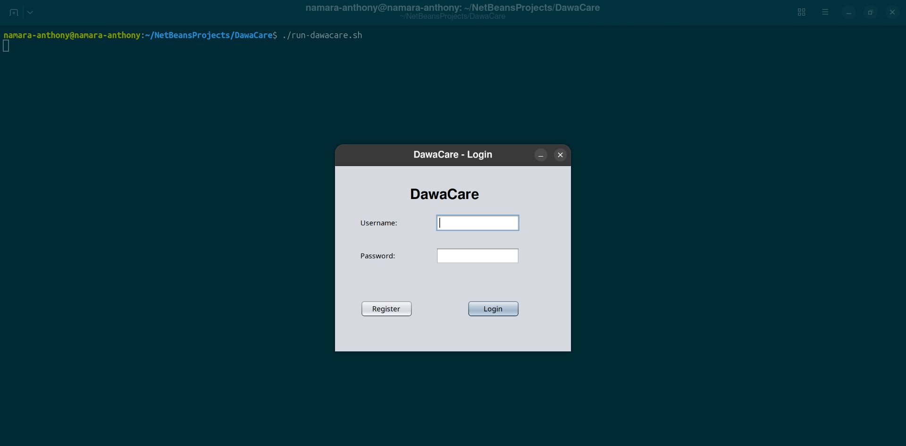
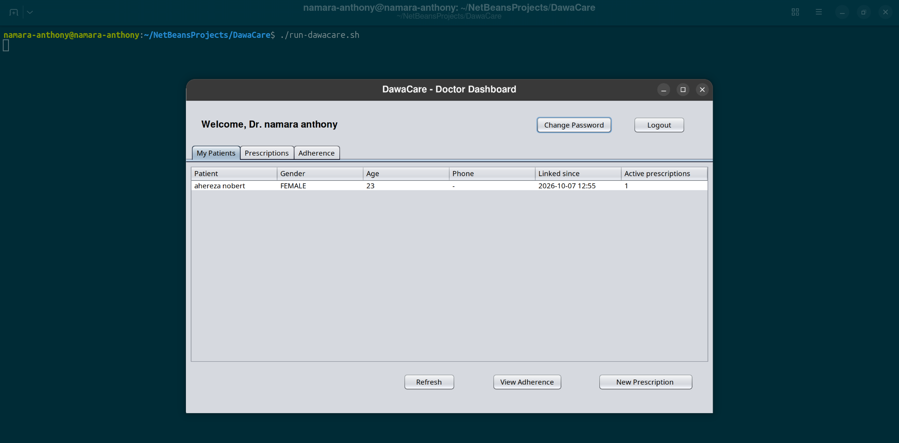
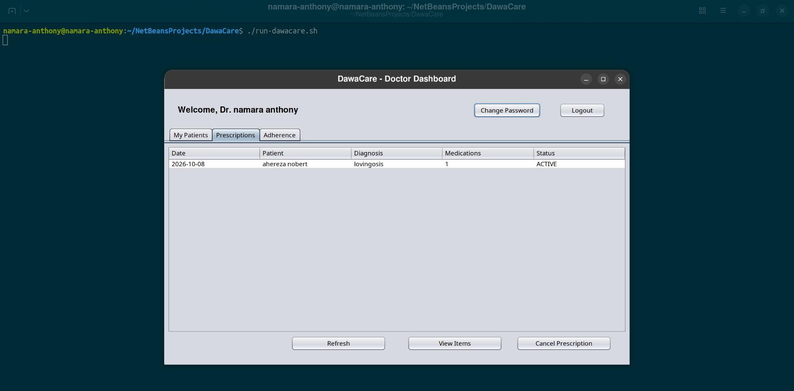
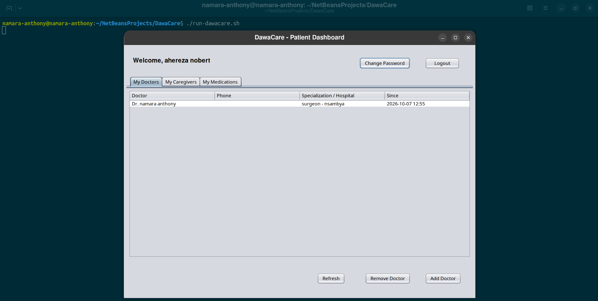
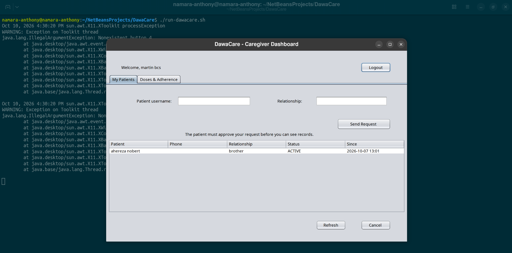
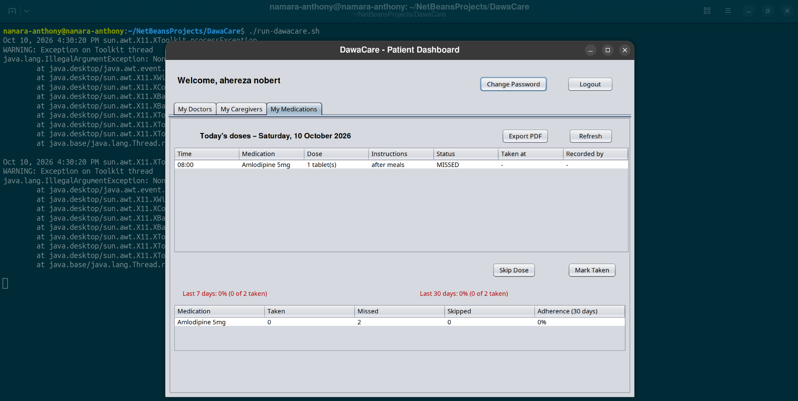

# DawaCare – Medication Adherence System

DawaCare is a desktop application that helps patients take their medication on time and lets doctors and caregivers follow how well treatment plans are being followed. Doctors write prescriptions, the system turns them into a daily dose schedule, patients (or their caregivers) record each dose, and everyone involved sees the resulting adherence rate.

*"Dawa" means "medicine" in Swahili.*

## Features

### Patient
- Choose their doctor(s) from the list of verified doctors
- Approve or decline caregiver access requests, and revoke access at any time
- See today's doses and mark each one as **taken** or **skipped**
- View adherence for the last 7 and 30 days, overall and per medication
- Get on-screen reminders when a dose is due
- Export a PDF adherence report

### Doctor
- Registers with a license number; can only log in after an administrator verifies it
- View linked patients and write prescriptions with several medications, doses, times of day, repeat patterns and durations
- Cancel prescriptions (all upcoming doses are cancelled automatically)
- View each patient's doses and adherence (read-only) and export PDF reports

### Caregiver
- Request access to a patient by username; the patient must approve it
- View and record doses for approved patients
- Get alerts when a patient misses a dose
- Export PDF adherence reports

### Administrator
- Approve or reject doctor registrations
- Activate or deactivate user accounts
- Manage the medication catalogue (medications already used in prescriptions are protected from changes that would alter past records)
- View a searchable audit log of important actions

### System
- Automatically generates every scheduled dose when a prescription is saved
- A background job marks overdue doses as **missed** after a 2-hour grace period and completes finished prescriptions
- Adherence = doses taken ÷ (taken + missed + skipped); upcoming and cancelled doses never count against the patient

## Screenshots

## Screenshots

| Login | Doctor dashboard |
|---|---|
|  |  |

| New prescription | Patient doses & adherence |
|---|---|
|  |  |

| Caregiver dashboard | Medication catalogue (Admin) |
|---|---|
|  |  |

A sample PDF report is available in [`docs/sample-report.pdf`](docs/sample-report.pdf).| Login | Doctor dashboard |
|---|---|
|  |  |

| New prescription | Patient doses & adherence |
|---|---|
|  |  |

A sample PDF report is available in [`docs/sample-report.pdf`](docs/sample-report.pdf).

## Tech stack

| Area | Technology |
|---|---|
| Language | Java 25 |
| User interface | Java Swing (NetBeans GUI Builder) |
| Database | MySQL 8.4 via JDBC |
| Build | Maven (runnable "fat" jar via Maven Shade) |
| Password hashing | BCrypt (jBCrypt) |
| PDF reports | OpenPDF |

## Architecture

The code follows a layered design so the user interface never talks to the database directly:

```
ui        Swing windows, dialogs and panels
service   Business rules and access checks (who may see or change what)
dao       All SQL, using PreparedStatement only
model     Data classes (Java records and enums)
util      Database connection, password hashing, session
jobs      Background missed-dose / prescription-completion job
report    PDF report generation
```

Every request for patient data goes through an access check in the service layer: a patient sees only their own records, while doctors and caregivers see only patients linked to them through an **active** link.

## Security
- Passwords are stored as BCrypt hashes, never as plain text
- All SQL uses parameterised queries (protection against SQL injection)
- Doctors cannot log in until an administrator verifies their license
- Caregivers need the patient's explicit approval before seeing any records
- Multi-step operations (registration, prescriptions, approvals) run in database transactions
- Medical records are never hard-deleted; accounts are deactivated instead
- Key actions, including report exports, are written to an audit log

## Getting started

### Requirements
- Java (JDK) 25 or newer
- MySQL 8.0.16 or newer
- Maven, or Apache NetBeans (which includes Maven)

### 1. Create the database

```bash
mysql -u root -p < database/schema.sql
mysql -u root -p < database/seed_medications.sql
```

Then create a database user for the application:

```sql
CREATE USER 'dawacare'@'localhost' IDENTIFIED BY 'choose-a-password';
GRANT ALL PRIVILEGES ON medical_adherence_db.* TO 'dawacare'@'localhost';
FLUSH PRIVILEGES;
```

### 2. Configure the connection

Copy the example settings file and fill in your password:

```bash
cp src/main/resources/db.properties.example src/main/resources/db.properties
```

### 3. Build and run

```bash
mvn clean package
java -jar target/DawaCare.jar
```

Or open the project in NetBeans and press **F6**.

On Linux with a high-resolution screen, use `./run-dawacare.sh` for correct scaling.

To run the jar on another computer, place a `db.properties` file in the same folder as `DawaCare.jar`; it overrides the built-in settings.

### Default administrator

| Username | Password |
|---|---|
| `admin` | `Admin@123` |

**Change this password immediately after the first login** using the *Change Password* button.

## Limitations and future work
- Reminders only appear while the application is open (it is a desktop app)
- Appointments and medical-condition records exist in the database design but have no screens yet
- Possible extensions: SMS/email reminders, a mobile companion app, adherence charts

## Author

**Namara Anthony** – [@anthonynamara1-689](https://github.com/anthonynamara1-689)

Developed as coursework for a Java OOP / Swing / JDBC module.
